<div align="center">
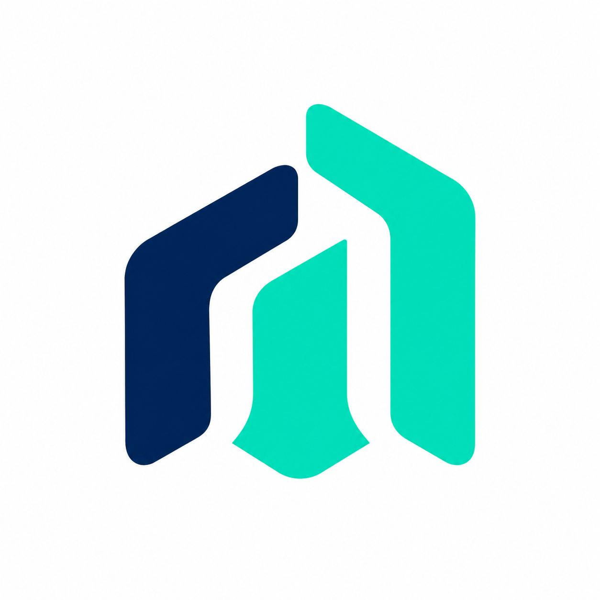

# NextRole

### A better way to move forward.

**Discover opportunities. Build your profile. Follow your next step.**

A Flutter job discovery and hiring workspace with a public jobs feed and Firebase powered candidate, employer and administrator workflows.


[Quick start](#quick-start) · [Product tour](#product-tour) · [Firebase setup](START_HERE.md) · [Verification](VERIFICATION.md)

</div>

## The experience

NextRole brings two kinds of opportunity into one candidate workspace: live external listings from Arbeitnow and approved vacancies published by employers within the app. Each has its own application path, so users can tell where their information goes and which applications NextRole can track.

The interface uses a navy and mint identity, light and dark appearance, bottom navigation on compact screens and a navigation rail on wide layouts. Profile readiness, wrapping job metadata and clear loading, error and empty states support everyday use.

## Product tour

These are actual supplied Android screenshots. Empty states represent the captured workspace; they are not populated with invented application or hiring results. The gallery follows the candidate journey.

### 1. Enter your workspace

<table>
<tr><td align="center" width="33%">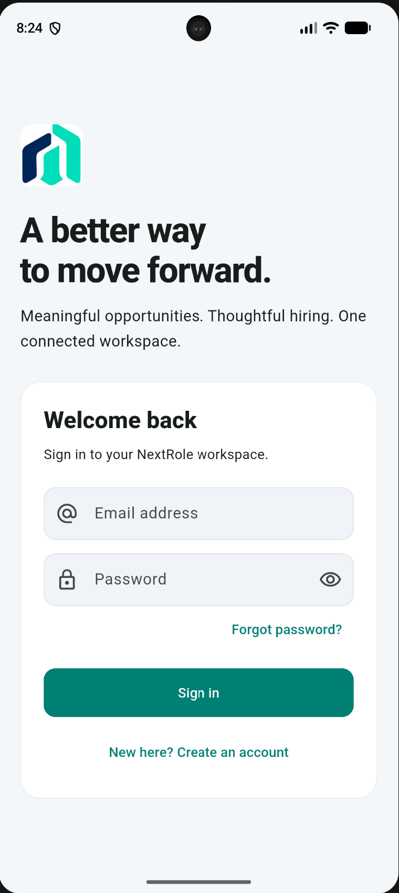<br /><strong>Sign in</strong></td><td align="center" width="33%">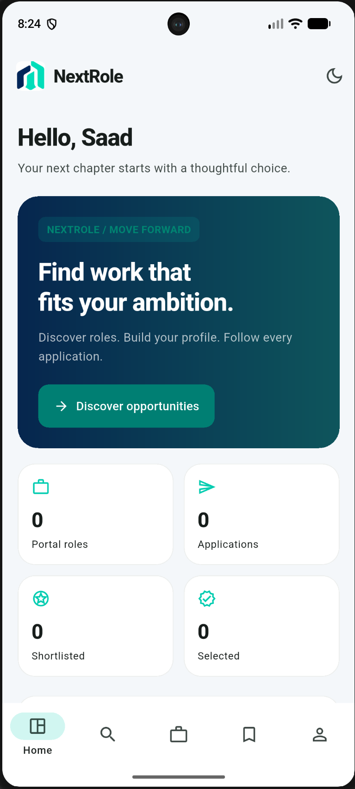<br /><strong>Candidate dashboard</strong></td><td align="center" width="33%">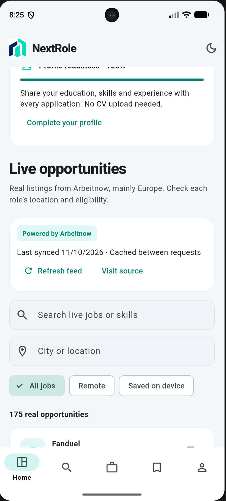<br /><strong>Live feed on Home</strong></td></tr>
</table>

### 2. Discover roles across both sources

<table>
<tr><td align="center" width="33%">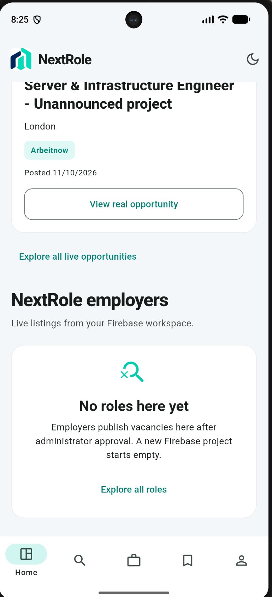<br /><strong>Employer workspace listings</strong></td><td align="center" width="33%">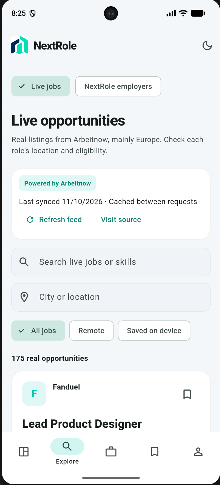<br /><strong>Explore live opportunities</strong></td><td align="center" width="33%">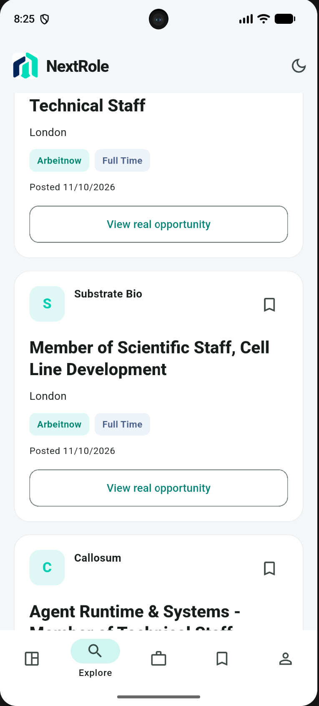<br /><strong>Job cards and bookmarks</strong></td></tr>
</table>

### 3. Read the opportunity and choose your next step

<table>
<tr><td align="center" width="33%">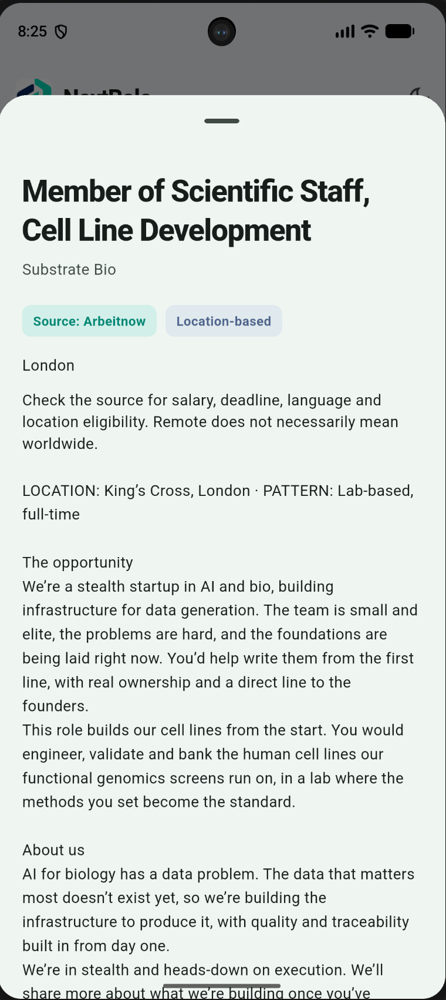<br /><strong>Job detail sheet</strong></td><td align="center" width="33%">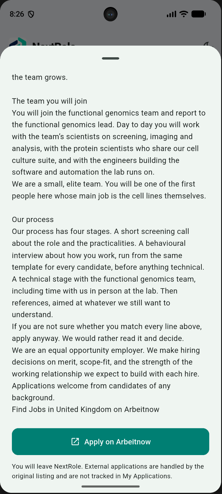<br /><strong>Apply on the original source</strong></td><td align="center" width="33%">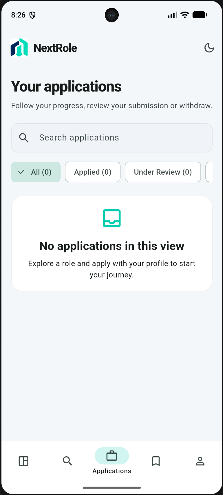<br /><strong>Application tracking</strong></td></tr>
</table>

### 4. Keep your shortlist and profile ready

<table>
<tr><td align="center" width="33%">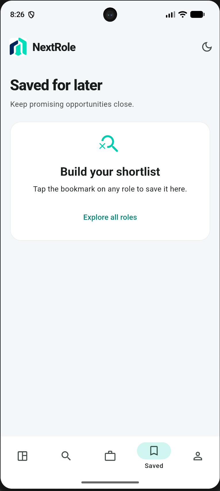<br /><strong>Saved portal jobs</strong></td><td align="center" width="33%">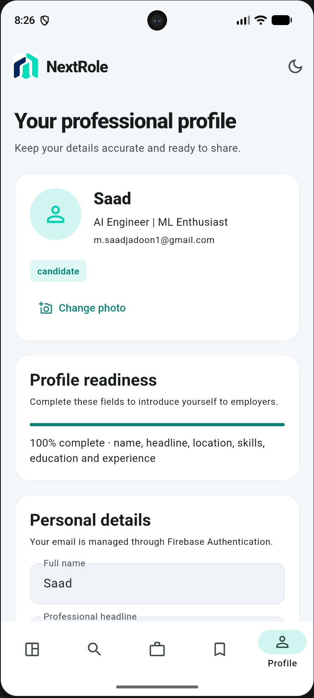<br /><strong>Profile and readiness</strong></td><td align="center" width="33%">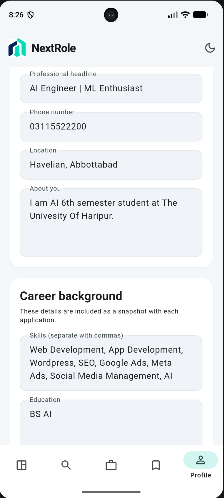<br /><strong>Career background editor</strong></td></tr>
</table>

### 5. Switch the atmosphere

<table>
<tr><td align="center" width="33%">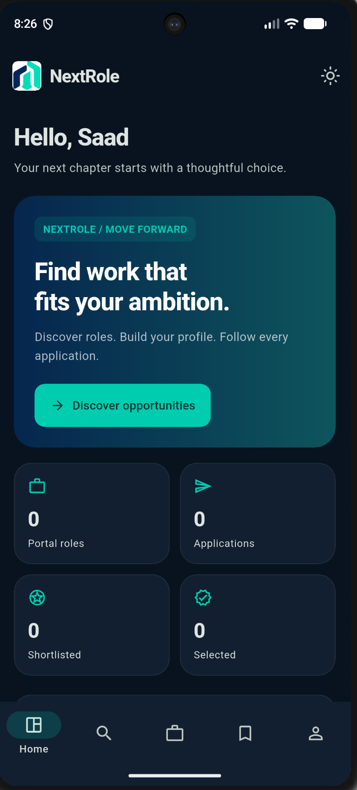<br /><strong>Dark appearance</strong></td></tr>
</table>

The final screen shows the same dashboard in dark appearance. For full resolution, open an image in [the screenshot directory](docs/screenshots).

## Two sources, clear boundaries

| | Live external jobs | NextRole employer vacancies |
| :--- | :--- | :--- |
| Source | Arbeitnow public API | Your Firebase workspace |
| Discovery | Search, location, remote filter | Search, type, mode, field and sorting |
| Application | Opens the original source in the browser | Profile snapshot and cover note inside the app |
| Tracking | Managed outside NextRole | Applied, Under Review, Shortlisted, Selected, Rejected or Withdrawn |
| Bookmarks | Saved on this device | Saved to your portal profile |

The feed mainly covers Europe and loads the first/latest API page. Location and eligibility should be checked on the original listing. It refreshes on initialization when its six hour cache is stale; manual refresh has a five minute cooldown. Cached jobs remain visible when a request fails. External applications do not appear in My Applications. No API key is required for this integration.

## One connected hiring journey

An employer completes a company profile, an administrator approves it, and vacancies move through review before they appear in candidate discovery. Candidates apply with their profile and cover note; employers review those snapshots and update decisions. Candidates follow their progress and can withdraw eligible applications.

The interface includes: compact discovery, expandable filters, adaptive job cards, a dedicated applicant review sheet, hiring insights and a sectioned profile editor. The supplied logo remains the brand reference.

| Candidate | Employer | Administrator |
| :--- | :--- | :--- |
| Search title, company, skills and location | Editable company identity | Approve companies |
| Filter type, mode and career field | Create and edit vacancies | Approve or reject listings |
| Sort newest, deadline or skill relevance | Close/reopen approved vacancies | Suspend/reactivate other accounts |
| Save and unsave roles | Review submitted profile snapshots | Investigate listing reports |
| Apply with profile and cover note | Update hiring decisions | Inspect workspace applications |
| Track, search and withdraw applications | View pipeline and role counts | Console-controlled administrator roles |

Both account types support editable personal details and photos, appearance preferences, password reset and verification email actions. Role switching is available only in local demo mode.

## Data and permissions

Firebase Authentication handles accounts. Cloud Firestore stores profiles, portal vacancies, application snapshots and reports. Employers need administrator approval; their vacancies also pass review before candidate discovery. Administrator roles are assigned through the Firebase Console, not through public registration.

This edition does not use Firebase Storage. Applications use profile details and a cover note; PDF CV upload is not included. Small compressed profile photos are stored in the profile document. Firebase quotas and rules still apply.

## Quick start

Use Flutter 3.35 or newer with Dart 3.9 or newer, an Android SDK and an emulator. iOS builds require macOS. This repository is a source package: bootstrap generates Android, iOS and web platform files.

From the repository root in PowerShell:

```powershell
Set-ExecutionPolicy -Scope Process -ExecutionPolicy Bypass
.\scripts\bootstrap.ps1
flutter devices
flutter run -d emulator-5554 --dart-define=DEMO=true
```

Replace the device ID with the one reported by `flutter devices`. Demo mode uses clearly labelled local sample vacancies and role switching. Automatic live jobs are enabled in normal Firebase mode, not demo mode.

### Connect your Firebase project

Enable Email/Password in Firebase Authentication and create Cloud Firestore before deploying rules. With Firebase CLI and FlutterFire CLI installed:

```powershell
firebase login
dart pub global run flutterfire_cli:flutterfire configure --project=YOUR_PROJECT_ID --platforms=android
firebase deploy --only firestore --project YOUR_PROJECT_ID
flutter run -d emulator-5554
```

Use your actual Firebase project ID. The Android application ID is `com.saadi.nextrole`. Stop the app completely and restart after configuration. The shipped `lib/firebase_options.dart` is an intentional placeholder: normal mode cannot connect until FlutterFire generates your configuration. See [START_HERE.md](START_HERE.md) for the complete setup and first administrator instructions.

**Updating an existing app:** preserve your working `lib/firebase_options.dart` and `android/app/google-services.json`. Do not replace them with this package's placeholder. [PUBLISHING.md](PUBLISHING.md) explains how to transfer your verified local project into the repository.

## Check it locally

```powershell
flutter pub get
dart format lib test scripts
flutter analyze
flutter test
flutter build apk --debug --dart-define=DEMO=true
```

Or run `.\scripts\verify.ps1` after bootstrap. The debug APK is written to `build/app/outputs/flutter-apk/app-debug.apk`.

Security rules can be checked separately with Node, Java and Firebase CLI:

```powershell
npm ci --prefix tests/security
firebase emulators:exec --only firestore --project demo-nextrole "cd tests/security && npm test"
```

The included GitHub Actions workflow runs Flutter analysis, tests, a demo APK build and Firestore rules tests. Its presence is not evidence of a passing run. This delivery has source syntax, JSON, screenshot reference and archive checks; Flutter analysis, tests and native builds have not been executed here. Full details are in [VERIFICATION.md](VERIFICATION.md). Complete the [live acceptance checklist](docs/ACCEPTANCE.md) with candidate, employer and administrator accounts before release.

## Inside the repository

| Location | Responsibility |
| :--- | :--- |
| `lib/main.dart` | Role based workspace and navigation |
| `lib/forms.dart` | Sign in, profile, vacancy and application forms |
| `lib/live_jobs.dart` | Public feed, cache, local bookmarks and source links |
| `lib/store.dart` | Authentication, Firestore listeners and demo persistence |
| `lib/models.dart`, `lib/ui.dart` | Models, filtering and responsive components |
| `firestore.rules` | Authorization and protected application snapshots |
| `test/`, `tests/security/` | Flutter regression tests and Firestore emulator tests |
| `scripts/` | Bootstrap, verification and configuration migration |
| `docs/screenshots/` | All 13 original screenshots in journey order |
| `.github/workflows/` | Automated verification workflow |

## Current boundaries

Skill relevance counts matching profile skills; it is not AI matching or a hiring recommendation. Profile readiness measures completed fields. There is no CV upload, chat, push service, external application tracking or production monitoring in this edition. A withdrawn portal application cannot be restored or submitted again for the same vacancy.

The supplied gallery shows candidate screens. Employer and administrator capabilities are implemented in the source, but are not represented by these screenshots. No production readiness claim or software license is implied; choose an appropriate license before inviting reuse.
